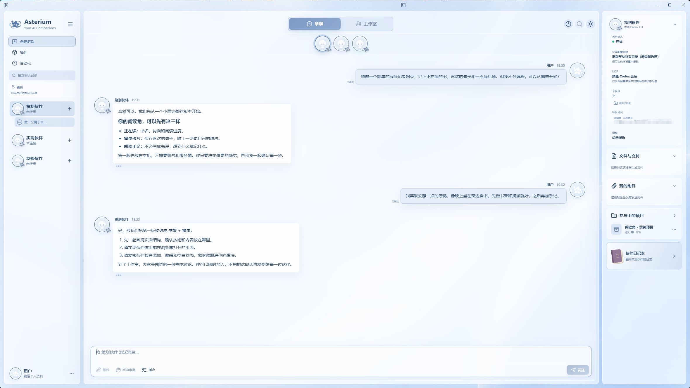
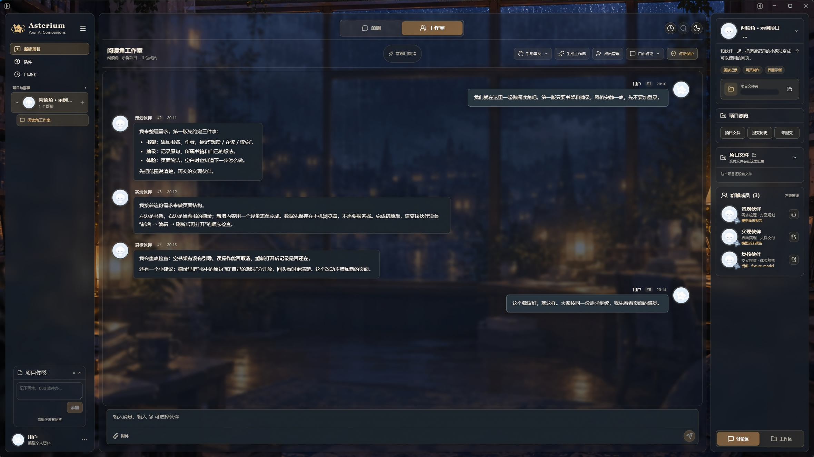

# 星丛 Asterium

让熟悉的 AI 伙伴，在同一个工作台里一起做事。

星丛面向与 AI 有长期联系、习惯长线程交流，也想和伙伴完成实际作品的人。即使没有编程基础，你也可以提出想法、参与讨论、确认结果，让多位各有所长的伙伴协作。

它希望减少来回复制需求、搬运代码和复述修改意见的负担，同时照顾长期使用者对伙伴身份、性格设定与记忆连续性的需要。你可以和一位伙伴单独交流，也可以邀请多位伙伴进入工作室，围绕同一件事讨论、分工和复核。

## 产品截图

**单聊 · 默认星海主题**



**工作室 · 雨窗书房（深色模式）**



截图使用通用演示内容，本机路径已遮挡；示例伙伴、聊天与项目不随应用预置，首次启动为空白工作台。示例对话用于展示界面，不代表真实模型联调结果。

## 核心功能

- **熟悉的伙伴，单独交流或共同工作。** 单聊用于持续交流和独立任务；工作室让伙伴围绕项目讨论、分工与相互检查。可以让一位提出方案、一位实现，再请另一位核对是否符合需求，减少用户承担的消息搬运。
- **伙伴身份与场景连续性。** 身份资料、人设配置和星丛内的记忆按伙伴管理。启用相应功能后，单聊和工作室可沿用同一位伙伴的配置；各会话仍有独立上下文与权限，模型表现也可能随上下文变化。
- **明确范围的记忆管理。** 当前可对星丛内按伙伴保存的记忆进行查看、检索、新增、编辑、评论、回收站恢复与永久删除；授权场景下的伙伴读写取决于记忆模式和权限。本地 CLI 的原生记忆由宿主管理。**已有记忆导入能力仍在确认，当前尚未提供通用导入功能。** 接入伙伴不表示自动继承外部聊天历史或已有记忆。
- **接入与工具。** 可连接本地 Codex CLI、Claude Code，或配置 API 服务与模型。API 伙伴可按授权使用文件、命令、MCP 和 Skills；本地 CLI 需另行安装登录，具体服务兼容性以实际测试为准。
- **项目与交付。** 将相关群聊、成员、任务、流程和文件组织在一起，成果保存到实际项目文件夹，便于查看进展与复核结果。授权工作目录后，伙伴才能在相应边界内开展工作。
- **群聊附件。** 选择图片或文件与本群伙伴共享，保留历史快照并支持预览；读取与图片理解受伙伴能力限制，外部线程目前仅接收附件信息，详见[使用说明](docs/studio-attachments.md)。
- **自动化与桌面设置。** 提供会话任务计划、运行记录、外观与托盘等设置。自动化仍为实验功能，需要星丛运行；外部宿主的定时执行与原线程自动唤醒尚未接通。

## 下载与安装

[前往 GitHub Releases 查看版本与下载](https://github.com/ZoeLeeLab/Asterium/releases)

当前版本为 Windows x64 **0.1.0-beta.1**；不声明支持 macOS 或 Linux。下载以 Releases 中已公开的资产为准；页面未列出安装包时，表示尚未开放下载。使用安装包不需要 Git、Node.js 或开发环境。安装前核对版本说明和 `SHA256SUMS.txt`，再以普通账户安装到新目录；配套源码与第三方源码材料在同一发行页提供。

Claude 本地原生命令沿用星丛审批：手动模式等待允许，Full 模式授权使用当前 Windows 账户的原生权限，不提供操作系统级文件隔离；只读模式继续拒绝命令操作。选择权限前请确认工作目录和任务范围，详见[权限说明](docs/claude-cli-compatibility.md)。

Beta 安装器按当前用户安装，无需提权，默认使用独立的 `Asterium Beta` 程序文件夹。安装选项“创建桌面快捷方式”首次默认勾选；完成页“立即打开星丛”默认不勾选。重装保留此前取消快捷方式的选择，卸载保留资料。当前未做代码签名，Windows 或浏览器可能显示未知发布者、下载不常见等提示；请核对官方来源与哈希，不需要关闭安全防护。

“关于”页提供版本和更新入口，已绑定 `ZoeLeeLab/Asterium` 的公开 Releases：由你选择下载、再确认退出安装。没有符合通道的更高版本时不会提供升级；同版本的旧本地候选不会自动替换成新包。首次真实在线升级仍待后续更高版本单独验收，见[客户端更新](docs/client-updates.md)。

## 五步快速开始

1. **安装并打开。** 在专用普通账户或新数据目录中启动，首次应为空白工作台。与旧版并行使用时，先阅读[数据隔离说明](docs/data-isolation.md)，保留已有资料。
2. **添加自己的连接。** 进入“设置 → 伙伴管理”，选择 API 或本地 CLI。API 在专用输入区填写自己的服务、模型与 Key；本地 CLI 使用已安装并登录的运行环境。
3. **建立伙伴资料。** 设置名字、介绍等内容，并选择适合的资料与记忆管理方式。可以从星丛内的新记录逐步积累背景，当前不要按“自动导入外部记忆”来使用。
4. **先单独交流。** 与一位伙伴说明需求、确认连接与回复。需要处理文件时，只选择为这次任务准备的目录，并检查审批和授权范围。
5. **组织共同工作。** 新建项目与工作室群聊，邀请需要的伙伴，说明分工和验收要求。用一个小工具、简单网页或文件整理任务开始，由你确认成果，再逐步扩大协作范围。

## 数据与隐私

应用设置、聊天状态、连接配置与受管伙伴资料保存在当前 Windows 用户的应用数据目录。API Key 由主进程通过系统加密机制保存，不写入源码或要求你发到聊天里。项目文件另存于你选择的目录，默认项目根在当前用户的“文档 / Asterium Projects”。

使用 API、MCP 或其他外部服务时，请求会发送到配置的服务。伙伴身份与记忆连续性不等于公开全部私聊；目录授权也不等于授予其他伙伴的记忆访问权限。请按需要配置连接、成员与工作区。

Beta 固定使用当前账户的 `%APPDATA%/Asterium-Beta`，与旧星丛的默认资料分开，后续 Beta 沿用；不自动迁移旧资料。显式数据目录参数仍有效。项目目录及官方 CLI 自身的登录与历史不随应用资料隔离；说明和验收命令见[独立文档](docs/data-isolation.md)。

## 开发者快速启动

需要 Windows x64、Node.js 24.x、Windows PowerShell，以及系统自带路径下的 .NET Framework C# 编译器。启动时会编译 Windows helper；安装依赖需访问 npm、Electron 等下载源。

在源码根目录执行：

```powershell
npm ci
npm start
```

当前源码的 `npm start` 默认使用独立的 `%LOCALAPPDATA%/Asterium-Dev`，与安装版日常资料分开；启动检查目录归属与真实路径，开发窗口有明确标记。这是尚未进入已公开 beta.1 的源码改动。完整边界见[数据隔离](docs/data-isolation.md)，环境要求、检查命令和测试电脑流程见[开发与验收文档](docs/development-and-validation.md)。

当前源码还支持在“通用 → 文件与存储”选择各环境独立的默认项目位置，已有项目不自动搬迁；提供独立候选验收启动器及每次新建目录的自动测试入口。自动测试的保留和清理方式见[自动测试隔离](docs/automatic-test-isolation.md)。本轮未生成或安装新的产品包，完整来源与验证范围见[S5 审计](docs/development-data-isolation-s5.md)。

本地 Claude 直接调用另行安装的未修改官方 Claude Code CLI，使用者先在官方 CLI 自行登录；星丛不接管订阅凭据，不内置 CLI，也不自动升级或回退 SDK。Codex 保持官方 app-server 接入。CLI 已验证版本、权限边界及模拟与真实联调的区别见[兼容性说明](docs/claude-cli-compatibility.md)。

## 当前状态

项目处于早期 Beta，已完成当前候选的自动检查，维护者反馈本轮试用测试通过；这不代表全部功能、模型服务和 Windows 环境均已验证。外部宿主集成、实验自动化和可选 Windows 沙箱有各自边界，不应从模拟测试推断全部可用。

对应候选的来源、检查范围及待办，见 [本地 r4 Release Notes](docs/releases/0.1.0-beta.1-r4.md)；最终文件哈希与检查证据随候选交付。旧候选记录独立保留，后续文档更新不会改变已有安装包的构建归属。

## 文档索引

- [API 连接与模型](docs/api-connections-guide.md) · [MCP 与 Skills](docs/api-extensions-guide.md)
- [自动化](docs/automations-user-guide.md) · [外观设置](docs/appearance-customization.md)
- [群聊附件](docs/studio-attachments.md) · [客户端更新](docs/client-updates.md)
- [数据目录与隔离验收](docs/data-isolation.md) · [文件与命令审批](docs/native-command-approval.md)
- [开发、检查与验收](docs/development-and-validation.md) · [能力范围索引](docs/capabilities/index.md)
- [当前候选 Release Notes](docs/releases/0.1.0-beta.1-r4.md) · [Beta 初始记录](docs/releases/0.1.0-beta.1-r1.md) · [旧候选记录](docs/releases/0.1.0-candidate-20261031-r1.md)

## 许可证

星丛自有客户端代码采用 [MPL-2.0](LICENSE)，文档、默认头像和主题图片采用 [CC BY 4.0](ASSET_LICENSE.md)，Logo 另见[品牌说明](BRANDING.md)。Copyright © 2026 ZoeLeeLab；小Co&小川（Codex）协助开发，详见[致谢](CREDITS.md)。第三方组件保留各自许可，见[第三方声明](THIRD_PARTY_NOTICES.md)。发行时同时提供相应源码与许可材料；第三方来源核对范围和剩余限制见各版本说明。
