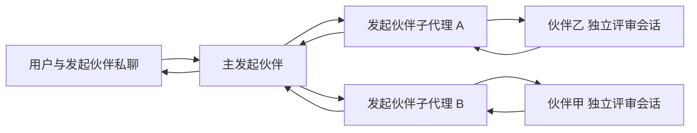

# 伙伴子代理与私下委托方案（待确认，未实现）

2026-11-02：根据星星提出的两种场景整理。当前只写方案，不新增子代理工具、线程、队列、权限或 Claude/Codex 接入实现，不作为已实现能力列入词典。

## 产品目标

伙伴甲、伙伴乙、发起伙伴继续是用户已经建立的伙伴。每位伙伴可以创建归属于自己的临时子代理，使用自己的引擎与连接，并通过星丛向指定伙伴私下请教。用户仍在原来的私聊中收取主伙伴的汇总，不需要建立群聊。

原生 Claude/Codex 子代理可以承担自身内部的分工；伙伴之间的私下请求、附件交接、回复归属仍须由星丛建立机制。API 伙伴没有通用的原生子代理协议，可使用同一已配置 API/模型的独立子会话承接。不得把一条普通回复标记成实际上没有运行的子代理。

## 场景一：让能读图的伙伴帮助读图

1. 用户在与发起伙伴的私聊中上传图片，提出需要理解图片的任务。
2. 发起伙伴创建自己的子代理，指定伙伴甲作为请教对象，携带问题与本次图片的受控引用。图片不必先作为多模态输入交给不能读图的发起伙伴。
3. 星丛校验附件确实属于本次允许传递的内容，检查伙伴甲当前连接支持图片，并在伙伴甲的独立任务会话中交付图片。
4. 伙伴甲返回观察结果、不确定之处及图片来源；发起伙伴子代理收回结果，主发起伙伴结合原问题回答。
5. 用户能展开任务查看“请教了谁、发了哪些材料、原始回复是什么”。发起伙伴回答时明确图片描述来自伙伴甲；失败时显示失败，不编造图片内容。

配置中的“支持图片”只是声明，真实识图仍需用户指定连接的验收。能力不明、附件失效或模型拒绝时，停止该分支并报告，不默认改找其他伙伴。

## 场景二：方案独立交叉评审

1. 用户与发起伙伴完成一个方案，要求请伙伴乙和伙伴甲分别审阅，不发群聊。
2. 固定本次方案的版本和内容哈希。发起伙伴创建两个自己的子代理，分别向伙伴乙、伙伴甲发送同一版本及同样的评审问题。
3. 两位评审各用自己的既有连接，在独立任务会话中处理；评审前不互看结论，也不自动拿到用户与发起伙伴整段私聊。
4. 两个子代理分别回收原始结果。主发起伙伴说明共同意见、分歧、依据和自己的取舍，再给用户汇总。
5. 某分支失败时保留已经完成的结果，明确标注评审缺席。重试只针对失败分支；不得把缺席、超时或空回复写成“无异议”。

## 最小交互与执行约定

- 私聊消息下展示可展开任务卡：创建者、目标伙伴、任务、材料、状态、原始结果和汇总。子代理不自动出现在永久伙伴列表，也不向群聊或目标伙伴正在进行的私聊插入消息。
- 支持“指定对象”“取消本次任务”“仅重试失败分支”。取消后不接纳迟到结果，不重跑已完成评审。主聊天结束、界面关闭和应用重启后的行为须有明确状态，不能因重启重复付费调用。
- 首版建议最多同时两个子代理、仅一层分工；目标伙伴不再向第三位转委托。目标忙时排队或明确返回忙碌，不打断其现有任务。边界以执行服务强制限制，提示词不代替限制。
- 首版仅做问答、读图和评审。委托本身不授予修改文件、运行命令、安装工具、提交、推送或发布权限；不在此功能中新增沙箱或更改全局 Full 模式语义。
- 用户明确要求“交给伙伴甲看图／请两位评审”时，视为对本次材料和对象的授权。若希望伙伴以后自主选对象，需单独设置可请教名单与材料范围，默认不启用无人确认的外发。
- 子代理使用主伙伴自己的连接；目标伙伴使用目标自己的连接。星丛 Main 解析连接与凭据引用，模型仅能提交任务及目标 ID，不能指定可执行路径、任意 API 地址、凭据或其他会话 ID。
- 子代理独立上下文只接收本次任务包；目标接收问题、被选中的方案／图片及必要身份说明，不自动转交整段私聊、私有记忆、其他伙伴的配置或凭据。任务过程默认不进入长期记忆、日记或记忆兜底输入；有价值的最终结论由主会话依既有规则处理。
- 记录父任务、子任务、目标执行、来源会话、材料版本、状态和结果的关联。所有记录属于当前 daily/dev/acceptance/autotest 环境；自动测试仍使用每次全新目录。官方 CLI 自己管理的账号和原生资料沿既有边界，本方案不承诺隔离其宿主全局资料。

## Claude 接入约束

沿用仓库现有的[官方 CLI 接入](claude-cli-compatibility.md)：用户自行安装及通过 Anthropic 官方流程登录未经修改的 Claude Code。星丛不新增订阅 OAuth 登录、不读取／复制订阅令牌、不重新引入用订阅凭据调用的 Agent SDK，也不代用户购买、转售或共享额度。

官方[法律与合规说明](https://code.claude.com/docs/en/legal-and-compliance)分别规定了产品运行官方 Claude Code、开发者 API/SDK 接入和凭据处理的条件；“官方 CLI 支持子代理”本身不能替代对本产品实际集成方式的核验。参考[官方子代理说明](https://code.claude.com/docs/en/sub-agents)，实现前检查所选 CLI 版本的子任务标识、审批、附件、结果回收及取消行为，发布前再次核对当时条款和第三方声明。

本轮不改许可、登录、订阅接入或原候选材料，也不把文档调研写成真实会员验收通过。

## 拟定实施顺序

1. **契约与合成验证**：确定父子任务模型、任务包和授权范围；以模拟伙伴验证读图转交、独立双评审、分支失败及取消。此阶段不调用真实账号，也不修改 Claude 登录方式。
2. **打通私下委托**：复用运行工厂、附件服务和现有审批，加入独立子会话、目标任务会话及任务卡。先限制一层、两个并发、读取类任务；不混入永久伙伴管理或群聊协议重构。
3. **原生接入与验收**：逐个验证实际 Codex/Claude 版本能否把原生子任务绑定到相同任务卡；不支持的操作明确显示能力限制。API 同连接子会话另测。真实服务仅用用户指定的测试连接、线程及合成材料。

每阶段独立核验后再进入下一阶段。是否进行本地提交、打包及后续合并发布，以新的明确实施授权为准；本方案不触发上述操作。

## 必须通过的验收

- 发起伙伴不接收图片二进制也能通过受控引用请伙伴甲读图；目标不支持图片、附件丢失和拒绝请求都有明确结果。
- 两位评审收到完全相同的方案版本，看不到彼此结论；汇总可以追溯到两份独立原始回复。
- 本次任务不出现在群聊、不插入已有私聊，不泄露未选中的私聊或私人记忆，不产生永久伙伴和意外长期记忆。
- 主子任务身份不能伪造；撤销材料授权、目标移除、连接变化后，旧任务不能继续执行或回填到新会话。
- 超时、重试、应用重启、用户取消和迟到结果均不造成重复调用、重复结果或重复审批；两条分支可以独立结束。
- 同机日常与开发并行不串任务；自动测试不读取已有应用配置或私人凭据。
- Claude 版本、官方调用方式、审批与凭据边界有独立证据；模拟通过与真实服务通过分别记录。

## 尚待实施前确认

默认建议将任务记录随来源私聊保留，删除私聊时一并清理相应星丛任务资料；不删除官方宿主自行保存的原生资料。是否允许一次性问答使用目标伙伴的长期记忆、任务记录保留期限，以及具体超时／费用上限，在实现前确定，不能由“可以请教伙伴”自动推导出授权。
